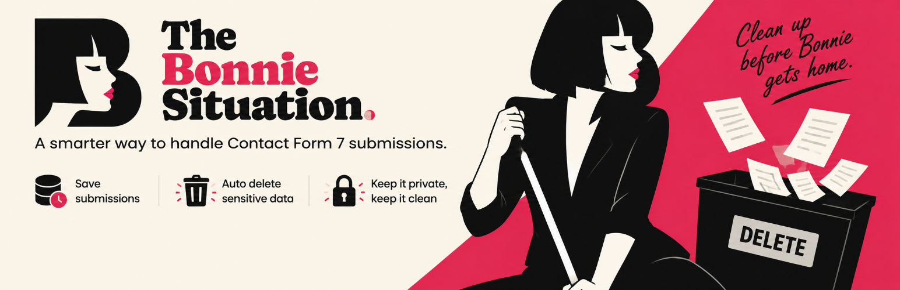
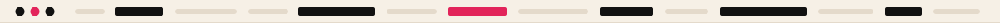
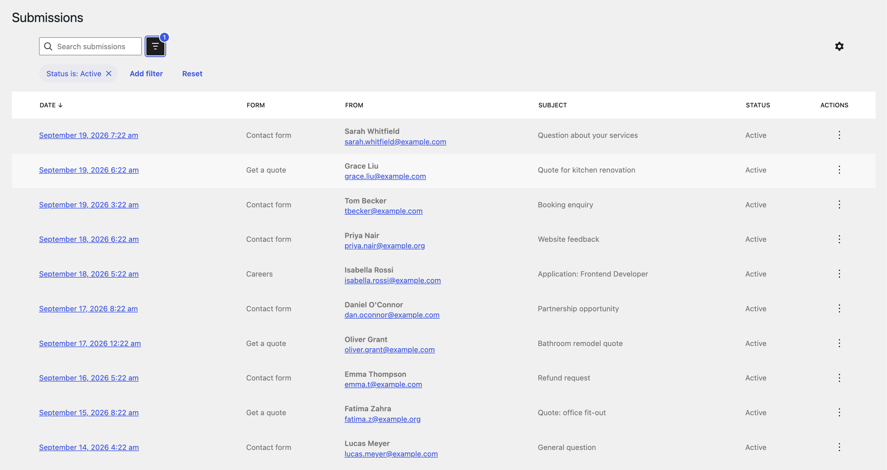
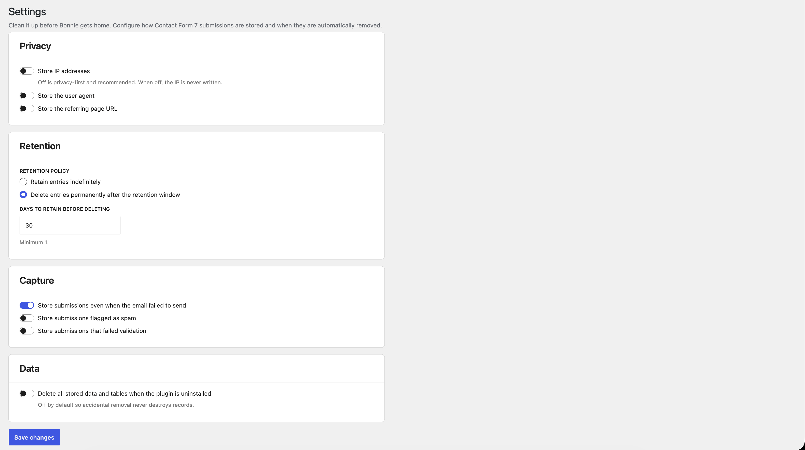
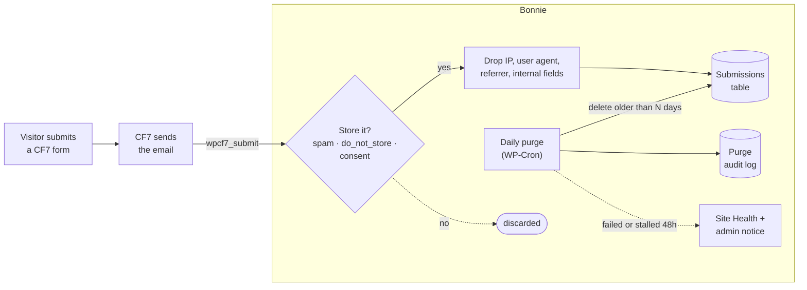

<div align="center">



<h1>The Bonnie Situation</h1>

<p><b>Save Contact Form 7 submissions to your database, then delete them on a schedule.</b><br>
Privacy-first defaults, an audit log of every purge, and a warning when cleanup stops working.<br>
<i>Clean it up before Bonnie gets home.</i></p>

[](https://wordpress.org/plugins/the-bonnie-situation/)


<sub><b>
<a href="#why">WHY</a> &nbsp;·&nbsp;
<a href="#what-it-does">FEATURES</a> &nbsp;·&nbsp;
<a href="#private-by-default">PRIVACY</a> &nbsp;·&nbsp;
<a href="#install">INSTALL</a> &nbsp;·&nbsp;
<a href="#how-it-works">HOW IT WORKS</a> &nbsp;·&nbsp;
<a href="#extending-bonnie">HOOKS</a> &nbsp;·&nbsp;
<a href="#development">DEVELOPMENT</a>
</b></sub>

</div>

<br>



## Why

Contact Form 7 doesn't store anything: once the email goes out, the submission is gone. The usual fix is a storage plugin that keeps every entry forever, IP address included, with no expiry. The moment your form collects a name and an email address, that's a growing pile of personal data you're responsible for.

Bonnie stores submissions **and treats them as a liability**:

- 🗑️ **Data expires.** Pick a retention window and a daily job permanently deletes anything older, with an audit log of every run.
- 🫥 **Collect less.** No IP address, user agent, referrer or spam unless you turn them on. CF7's own `do_not_store` and `consent_for:storage` opt-outs are honoured.
- 🚨 **Failures are loud.** If a purge errors, or stops running because WP-Cron isn't firing, you're told in Site Health and the dashboard. Data is never silently kept past its window.

> [!NOTE]
> Bonnie provides controls that support GDPR, UK GDPR, the Australian Privacy Act and CCPA. Your lawful basis and configuration are still your responsibility. This isn't legal advice.


## What it does

| | Feature | |
| :---: | --- | --- |
| 📥 | **Capture** | Every CF7 submission saved to its own table, *after* mail handling, so a storage error never blocks or delays the email |
| 🔎 | **Browse** | Search, sort and filter in a DataViews admin, with a detail view for each submission |
| ✂️ | **Delete** | Permanently delete one submission on demand |
| ⏳ | **Retention** | Delete everything older than *N* days, enforced daily by WP-Cron and logged |
| 🚨 | **Health checks** | A critical Site Health item and admin notice when a purge fails or none has succeeded for 48 hours. A missing cron event is recreated |
| 🧾 | **Subject requests** | Plugs into **Tools → Export / Erase Personal Data**, so a request by email includes captured submissions |
| 📦 | **Import** | One-click import from Flamingo and CFDB7, under your privacy settings and retention window. The source plugin doesn't need to be active |

<table>
<tr>
<td width="50%"><br><sub>Submissions list with status views, search and filtering</sub></td>
<td width="50%"><br><sub>Privacy &amp; Retention settings</sub></td>
</tr>
</table>


## Private by default

| | Default | |
| --- | --- | --- |
| IP address | **not stored** | Settings → Privacy |
| User agent, referrer | **not stored** | Settings → Privacy |
| Spam and validation failures | **discarded** | Settings → Privacy |
| CF7 internal fields (`_wpcf7*`) | never stored | |
| `do_not_store` forms, unticked `consent_for:storage` | never stored | |
| `do-not-store` tags (quiz, CAPTCHA) | never stored | |
| Retention | off until you choose a window (30 days suggested) | Settings → Retention |
| Data on uninstall | kept, unless you opt in to delete it | Settings |

> [!TIP]
> Enquiry forms rarely need more than 30 to 90 days. Set the shortest window you can, and let Bonnie do the rest.


## Install

| | |
| --- | --- |
| **WordPress** | 6.7 or later |
| **PHP** | 8.1 or later |
| **Contact Form 7** | Required (declared with `Requires Plugins`) |

**From WordPress.org** (recommended): **Plugins → Add New**, search for *The Bonnie Situation*, then install and activate. Or download it from [wordpress.org/plugins/the-bonnie-situation](https://wordpress.org/plugins/the-bonnie-situation/).

Then open **Bonnie → Settings** and choose your retention policy. Submissions are captured automatically from then on.

> [!IMPORTANT]
> Retention runs on WP-Cron, which only fires when someone visits the site. On a quiet site, call `wp-cron.php` from a real system cron so purges happen on time. If nothing succeeds for 48 hours, Bonnie will flag it.

<details>
<summary>Install from source</summary>

```bash
cd wp-content/plugins
git clone https://github.com/nicksull/the-bonnie-situation
cd the-bonnie-situation
npm ci && npm run build
```

`build/` is committed, so the build step is only needed if you change `src/`.

</details>


## How it works



1. **Capture** hooks `wpcf7_submit` at priority 20, after mail handling, wrapped so a storage error is logged rather than breaking the form.
2. **Filter** applies your privacy settings and CF7's opt-outs before anything is written.
3. **Purge** runs once a day, deletes rows older than your window in a transaction, and records the rows actually deleted.
4. **Watch** records every run. A failure, or no success for 48 hours, raises a critical Site Health item and a notice until the next good run.


## Bonnie Pro

The free plugin is complete on its own. [Bonnie Pro](https://beforebonnie.com/pricing?utm_source=github&utm_medium=readme&utm_campaign=upgrade) is a separate add-on, sold off WordPress.org, for agencies and sites with stricter requirements:

| | |
| --- | --- |
| 📤 **CSV / JSON export** | The current view or selected rows |
| 📇 **Address book** | Deduplicated contacts, linked to their submissions |
| ♻️ **Trash workflow** | Soft-delete with a restore window, plus a hard cap that force-deletes |
| 🧹 **Bulk delete** | Across selected submissions |
| 🎛️ **Per-form overrides** | Policy, window, IP rule and field mapping per form |
| 🎭 **IP anonymisation** | Store a masked address instead of the full IP |
| 🔐 **Encryption at rest** | Names, emails, subjects and fields encrypted, key in `wp-config.php` |
| ⌨️ **WP-CLI** | `wp bonnie purge` and `wp bonnie import` |
| 📣 **Failure alerts** | Email, Slack or webhook when cleanup fails, and when it recovers |


## Extending Bonnie

Bonnie Pro is built entirely on public hooks, so your own add-on can use them too. The full reference is in [`docs/HOOKS.md`](docs/HOOKS.md).

```php
add_action( 'bonnie_loaded', function ( Bonnie_Services $services ) {
	// React to every stored submission.
	add_action( 'bonnie_after_store', function ( $id, $row, $posted ) {
		// Push to a CRM, upsert a contact, ...
	}, 10, 3 );

	// Hear about failed purges (fires on every failure, so throttle).
	add_action( 'bonnie_retention_failed', function ( $message, $scope, $status ) {
		// Page someone.
	}, 10, 3 );
} );
```

| Area | Hooks |
| --- | --- |
| Capture | `bonnie_should_capture`, `bonnie_capture_remote_ip`, `bonnie_before_store`, `bonnie_after_store` |
| Read | `bonnie_read_submission`, `bonnie_read_submission_meta`, `bonnie_email_hash` |
| Delete | `bonnie_before_delete_submissions`, `bonnie_after_delete_submissions` |
| Retention | `bonnie_effective_retention`, `bonnie_purge_cutoff`, `bonnie_retention_after_run` |
| Health | `bonnie_retention_failed`, `bonnie_retention_stale`, `bonnie_retention_recovered` |
| Admin UI | `bonnie_submissions_list_header`, `bonnie_submission_detail_actions`, `bonnie.settings.cards` (JS) |


## Development

| Command | What it does |
| --- | --- |
| `npm install` | Install the build and wp-env tooling |
| `npm run build` | Compile `src/` to `build/` (committed, so stage it with any `src/` change) |
| `npm start` | Rebuild on change |
| `npx wp-env start` | Local WordPress at `http://localhost:8888`, with Contact Form 7. To test against [Bonnie Pro](https://beforebonnie.com/?utm_source=github&utm_medium=readme&utm_campaign=dev), add it in a `.wp-env.override.json` |
| `npm run test:php:setup` | Install PHPUnit inside wp-env (once) |
| `npm run test:php` | Run the PHPUnit suite (retention, deletes, store) |
| `npm run plugin-zip` | Build the distributable zip, filtered by `.distignore` |

### Layout

```text
the-bonnie-situation.php   Plugin header and bootstrap
includes/                  Capture, store, retention, cron, health, privacy, import, REST
admin/                     Submissions and settings screens
src/                       React (DataViews) admin source → build/
tests/                     PHPUnit suite
docs/HOOKS.md              Extension API
readme.txt                 The WordPress.org listing
```

### Releasing to WordPress.org

1. Bump the version: `npm run bump -- 1.4.0`. This updates the plugin header `Version:`, `BONNIE_VERSION`, `Stable tag` and `package.json`. It does **not** touch `BONNIE_DB_VERSION`; bump that by hand only when the schema changes (it triggers the upgrade routine).
2. Add a `= 1.4.0 =` entry under `== Changelog ==` (and `== Upgrade Notice ==`) in `readme.txt`. The script warns if the changelog entry is missing.
3. Commit and push to `main`.
4. Publish a GitHub Release (e.g. tag `1.4.0`).

Publishing the release runs [`deploy.yml`](.github/workflows/deploy.yml), which builds the admin bundles and deploys to WordPress.org SVN (`trunk` + `tags/<version>`, plus `.wordpress-org/` → `assets/`), then attaches the zip to the release. The SVN version comes from the plugin header, not the release name.

> [!NOTE]
> This `README.md` is for GitHub only. WordPress.org reads [`readme.txt`](readme.txt), and `README.md`, `docs/` and `.wordpress-org/` are excluded from the shipped plugin by `.distignore`. Keep user-facing changes in `readme.txt` in step with this file.

## Licence

[GPLv2 or later](LICENSE.txt) © 2026 Red Pocket
